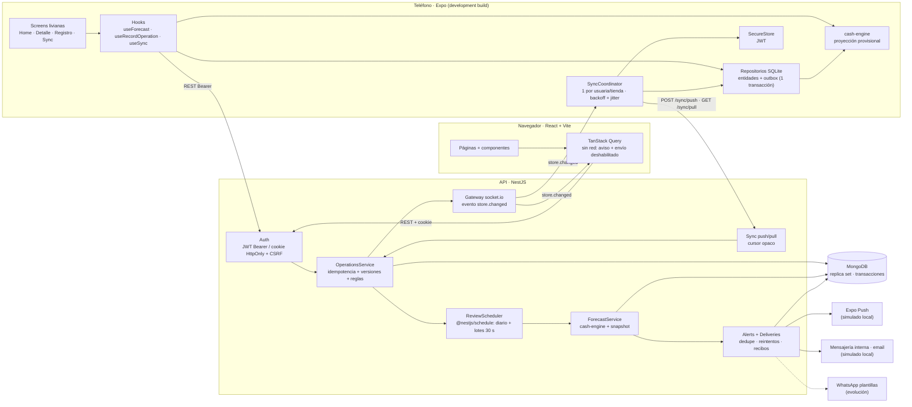
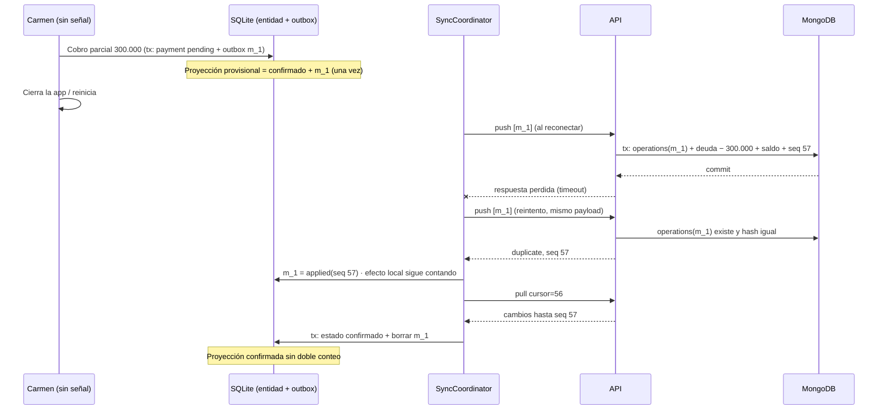

# Diseño · Caja a 14 días

Fuentes: enunciado `Pruebas técnicas.pdf` (requisitos y contratos del anexo), `PROPUESTA.md`
(decisiones del candidato y política financiera propuesta) y `.claude/rules/*` (convenciones). En este
documento se distingue:

- **[Reto]** requisito explícito del enunciado.
- **[Acuerdo]** decisión tomada por el candidato en `PROPUESTA.md`.
- **[Política]** regla propuesta para que el cálculo sea implementable; debe validarse con producto.
- **[Diseño]** decisión técnica tomada en esta especificación.

## Contexto

Necta tiene app Expo (sesión por token) y web React/Vite (sesión por cookie) sobre un backend Node +
MongoDB; ambas se identifican con `x-client-platform`. Las cuentas por cobrar/pagar nacen de ventas,
compras y gastos a crédito, con una sola fecha de vencimiento y pagos parciales con fecha. Cada
«bolsillo» guarda un saldo y un endpoint lo reconstruye desde los movimientos. Nada mira hacia
adelante, no hay pagos recurrentes, no hay cola sin conexión y las alertas push no evalúan la caja.

## Objetivos / No objetivos

Objetivos: responder si la caja cubre los compromisos de 14 fechas locales, cuándo y por cuánto
falta, de qué depende la respuesta y qué hacer; funcionar sin señal en el móvil; avisar a tiempo por
un canal que llegue.

No objetivos: pronóstico estadístico, LLM, datos de otras tiendas, WhatsApp, publicación (ver
`proposal.md`).

## Dónde profundizo y por qué

1. **El cálculo y su explicación** (motor puro con fixture completo): es la respuesta a Carmen; si es
   opaco o se equivoca, nada más importa.
2. **Sin señal y sin duplicados**: Carmen opera sin señal; si la app pierde o duplica un cobro, la
   proyección miente. Es donde el diseño tiene más riesgo técnico.
3. **Alertas**: profundidad media (dedupe, canales, reintentos simulados).
4. **Costo, despliegue, datos de otras tiendas**: postura argumentada, sin implementación.

---

## Decisiones

### D1. Saldo inicial: el guardado, con la diferencia visible [Acuerdo]

Se parte de **COP 1.900.000** (saldo guardado de los bolsillos) y se muestra la diferencia de
**COP 260.000** con el reconstruido (1.640.000) como advertencia, sin corregirla automáticamente.

- *Por qué*: con 20–30 % de captura, el reconstruido es el menos confiable de los dos (faltan
  movimientos); el guardado es lo que Carmen declaró tener. Corregir en silencio cambiaría su número
  sin que ella sepa por qué.
- *Descartado*: partir del reconstruido (castiga a la usuaria por no registrar todo); partir del
  menor de los dos (oculta la causa); corregir automáticamente (pierde trazabilidad).
- El saldo guardado **no** equivale a saldo verificado: la UI dice «saldo guardado», nunca
  «verificado». Una corrección de saldo es una operación explícita con fecha y trazabilidad
  (`POST /v2/banks/:id/adjustments`).
- **Fecha de referencia del saldo** [Política 2]: cada bolsillo tiene `balanceAsOf`. Un movimiento
  con fecha ≥ `balanceAsOf` afecta el saldo guardado; uno anterior (carga histórica del cuaderno)
  completa el historial, **no** cambia el guardado y aumenta la diferencia de conciliación.

### D2. Qué entra y qué sale [Política 3–9]

Saldo de cierre del día `d` = cierre de `d-1` + entradas(d) − salidas(d). Una sola moneda por cálculo
(la de la tienda), importes enteros en COP.

Entradas:

- **Ventas de contado habituales**: base semanal confirmada por la dueña (`cash-baseline`). Caso:
  260.000 lun–jue, 520.000 vie–sáb, 0 domingo. La quincena (+30 %) queda fuera del caso base.
- **Cobros programados**: una cuenta por cobrar entra en su fecha de vencimiento **solo si** vence
  dentro de la ventana, no está vencida y la contraparte es puntual: ≥ 3 pagos en 6 meses y ≥ 80 %
  a tiempo. Cada inclusión registra la regla y los datos usados (`basis`).
- **Cobros sin fecha confiable**: el resto (vencidas, pagadoras tardías, historial insuficiente, sin
  fecha individual) **no** suma al saldo; se listan aparte con su motivo. Ausencia de fecha ≠ cobro
  imposible.
- **No** se extrapola dividiendo lo registrado por el porcentaje de captura.

Salidas:

- **Cuentas por pagar** pendientes en su vencimiento (proveedor 4.200.000 el viernes 29).
- **Compromisos** cargados por la dueña: únicos o mensuales por días del mes (ayudantes 1.400.000 los
  días 15 y 30; arriendo 1.300.000 el día 1; cuota 650.000 el día 10). Un día inexistente (30 de
  febrero) cae en el último día del mes. Necta no puede inferirlos: si no están cargados, la UI lo
  pide como supuesto pendiente.
- **Gastos de contado habituales**: 90.000 cada día abierto (supuesto del ejemplo).

Realizado vs previsto:

- Pagos parciales reducen el pendiente; el motor solo proyecta el pendiente. Lo cobrado ya está en
  el saldo. Nunca se suma dos veces.
- Una venta a crédito no aumenta caja hasta su cobro.
- **Hoy**: en operación normal (`todayPolicy = none`) no se estima la venta restante de hoy; la dueña
  puede cargar una previsión explícita. En la demo con corte al inicio del lunes
  (`todayPolicy = fullDay`) se incluye la jornada completa y lo ya registrado hoy **consume** la base
  (base restante = max(0, base − realizado hoy)), para no contar dos veces.
- **Intradía**: el resultado diario es un cierre estimado. Si en un mismo día hay un cobro programado
  y un pago relevante y el orden se desconoce, se marca «depende del horario».

### D3. Margen de error: escenarios, no porcentajes [Acuerdo, Política 7]

- **Esperado**: reglas de D2.
- **Conservador**: el esperado **sin el cobro programado más grande** (prueba de estrés de la
  dependencia principal; en el caso, Hotel Brisas). No es un intervalo estadístico ni el peor caso.
- Se muestran supuestos («ventas habituales confirmadas por vos», «arriendo cargado por vos») y
  dependencias («el pago al proveedor depende de que Hotel Brisas pague el jueves»).
- *Descartado*: bandas P10/P90 o «85 % de confianza». Con seis meses de una tienda y captura parcial
  serían precisión inventada; además Carmen necesita saber *de qué* depende, no un número abstracto.

Estado global: `covered` (ambos escenarios sin faltante), `depends` (solo el conservador falta),
`short` (el esperado falta). Primer faltante = primer día con cierre < 0 en cada escenario.

### D4. Acciones recomendadas con impacto [Diseño]

El motor simula cada acción y devuelve su impacto (nuevo primer faltante o saldo mínimo):

1. **Confirmar un cobro del que dependés**: cada cobro programado cuya ausencia crea o adelanta un
   faltante.
2. **Cobrar primero**: cobros sin fecha confiable con contraparte identificada, simulados como
   cobrados el día anterior al faltante; se ordenan por: cubre el faltante → días de atraso →
   monto. El grupo agregado sin contraparte individual no se recomienda como cobro puntual.
3. **Pedir plazo**: pagos negociables (cuentas por pagar y compromisos marcados `negotiable`) en o
   antes del faltante; se calcula el mínimo aplazamiento que lo evita dentro de la ventana.

Orden global: por fecha del riesgo que mitigan (lo más cercano primero); a igual fecha, confirmar →
cobrar → aplazar. Necta no envía mensajes a terceros ni negocia por la dueña.

### D5. Cuánta IA: reglas explicables, sin LLM ni modelos [Acuerdo, Reto §2]

| Opción | Sirve para | No sirve para |
| --- | --- | --- |
| Promedios y reglas | Base semanal confirmada, puntualidad por contraparte, cálculo explicable | Estacionalidad no observada |
| Modelo estadístico (ETS, Prophet, regresión) | Con años de datos completos y muchas tiendas | 6 meses, 1 tienda, 20–30 % de captura: sobreajusta y aparenta precisión |
| LLM | Convertir voz/foto en borradores (ya existe) | Sumar y restar con trazabilidad; cuesta créditos y varía entre llamadas |

Se usa reglas explicables. Evolución: extender `/v1/voice/extract-schema` a obligaciones futuras y
recurrentes con confirmación humana; medir el error del motor contra resultados reales antes de
considerar un modelo.

### D6. Sin señal y sin duplicados [Acuerdo, Diseño]

- **Móvil offline-first**: SQLite es la fuente de trabajo. Cada operación guarda la entidad
  (`sync_state = pending`) y su fila de outbox en **una** transacción. Sobrevive a reinicios.
- **Qué calcula el teléfono**: proyección provisional con el mismo motor, sobre el último estado
  confirmado + efectos de las operaciones pendientes aplicados una sola vez. Marcada «provisional,
  N pendientes». **Servidor**: proyección confirmada, alertas, idempotencia, conflictos.
- **Sin duplicados**: `clientMutationId` estable por operación (UUID v4 generado al crear). El servidor
  guarda `(storeId, clientMutationId)` con índice único, hash del payload y resultado, en la misma
  transacción que el efecto financiero. Reintento con el mismo payload → devuelve el resultado
  previo (`duplicate`); con payload distinto → `409 IDEMPOTENCY_PAYLOAD_MISMATCH`.
- **No doble conteo al reconciliar**: un push aceptado devuelve el `seq` del cambio. La operación
  pasa a `applied` pero **sigue aplicando su efecto** local hasta que un pull trae un cursor ≥ ese
  `seq`; en ese momento se borra de la outbox y se escribe el estado confirmado en la misma
  transacción SQLite.
- **Qué cambio gana (app vs web)**: ninguno en silencio. Cada entidad editable tiene `version`; las
  ediciones envían `baseVersion` y el servidor escribe condicionalmente. Si no coincide → conflicto
  con ambas propuestas; la dueña elige («usar la mía» genera una operación nueva sobre la versión
  remota; «usar la del servidor» descarta la local). Los *agregados* (saldo, pendiente de una deuda)
  nunca se editan: se derivan de operaciones conmutativas (cobros, pagos), así que dos cobros
  parciales desde app y web **suman** sin conflicto, con validación de negocio (no cobrar más que el
  pendiente).
- *Descartado*: last-write-wins por timestamp (relojes de teléfonos no confiables, pierde datos);
  CRDT (excesivo para entidades con reglas de negocio); bloquear edición offline (Carmen opera sin
  señal).

### D7. Cómo se entera Carmen [Acuerdo, Reto §3]

- **Dónde**: la conclusión es lo primero en el home de app y web; aviso persistente arriba mientras
  haya un faltante dentro de la ventana.
- **Cuándo**: revisión diaria (07:00 hora de la tienda) y tras cambios relevantes (agrupados en
  lotes de 30 s por tienda). Con ventana de 14 días, un faltante el lunes 1 se detecta desde el
  lunes 18 si los compromisos están cargados (≥ 1 semana de anticipación).
- **Canal**: push si hay dispositivo y preferencia; si no hay token, no hay permiso o el push falla
  sin recibo, **correo**; siempre el aviso persistente en app y web. WhatsApp exige plantillas
  aprobadas para mensajes iniciados por la empresa y el servicio interno hoy solo envía OTP: queda
  como evolución (canal con mejor alcance para Carmen).
- **Dedupe**: clave `storeId:tipo:escenario:fechaFaltante`; solo se notifica de nuevo si cambia la
  fecha, sube la severidad (`depends` → `short`) o el monto empeora > 10 %. Aceptación del push ≠
  entrega ≠ lectura: se consultan recibos aparte.

### D8. Datos de otras tiendas: no en v1 [Acuerdo, Reto §5]

Usar cómo paga Hotel Brisas a otras distribuidoras mejoraría la puntualidad estimada, pero hoy no
hay consentimiento ni reglas de privacidad, y revelaría relaciones comerciales de terceros. Si se
hace en el futuro: opt-in explícito de ambas partes, identificación de contrapartes por NIT con
hash con sal, agregados con k-anonimato (≥ 5 acreedores distintos), solo señales categóricas
(«suele pagar a tiempo»), nunca montos ni nombres de otras tiendas, y auditoría de consultas.

### D9. Costo y créditos [Acuerdo, Reto §6]

El motor es O(días × entradas): decenas de entidades por tienda, sin llamadas externas. El costo
dominante es leer de MongoDB (≈ 6 consultas indexadas por tienda) y escribir un snapshot. Se mide un
benchmark local del motor y se documenta en README (no se inventa un presupuesto mensual). Por eso
la proyección y las alertas básicas **no consumen créditos**: cobrarlas desincentivaría justo a las
usuarias en riesgo. Los créditos quedan para funciones con costo variable (voz/foto).

### D10. Tecnologías y despliegue [Reto §7, Diseño]

- **Monorepo** npm workspaces, TypeScript 6.0 (la plantilla de Expo SDK 58 usa `~6.0.3` y `ts-jest`
  requiere `<7`).
- **API**: NestJS 12, Mongoose 9, `@nestjs/schedule`, socket.io. **Web**: React 19.3 + Vite 8 +
  TanStack Query 5 + React Router. **Móvil**: Expo SDK 58, React Native 0.88, Expo Router, Expo UI
  (`@expo/ui`: `BottomSheet`, `Picker`, `Host`), `expo-sqlite`, `expo-secure-store`, `expo-network`,
  `react-native-svg`, TanStack Query.
- **Pruebas**: Jest + Supertest (API, MongoDB real en replica set dedicado), Vitest + RTL (web),
  Jest + `jest-expo` + RNTL (móvil), Vitest (motor y contratos).
- **Despliegue propuesto (no ejecutado)**: API en contenedores (Cloud Run / ECS Fargate) con MongoDB
  Atlas (replica set, requerido por transacciones); socket.io con adaptador Redis o sticky sessions
  al escalar; web estática en CDN (Vercel/Cloudflare Pages) con la API bajo el mismo sitio para la
  cookie `SameSite=Lax`. Revisión diaria: con varias instancias, mover a cola (BullMQ/Redis o
  *lease* en MongoDB) particionada por zona horaria.
- **Móvil**: EAS Build con perfiles `development` / `preview` / `production`, EAS Submit, EAS Update
  con canales homónimos y `runtimeVersion` por política `fingerprint`. Sin `projectId` real, la
  configuración queda preparada y desactivada (ver README).

---

## Contratos

Los contratos del anexo se preservan. Extensiones (todas bajo `/v2`, encabezados comunes:
`x-client-platform: mobile|web` —identifica, no autoriza—, `x-store-id` —validado contra las tiendas
de la usuaria— y `Authorization: Bearer` (móvil) o cookie `necta_session` + `x-csrf-token` (web)).

### Sesión

```http
POST /v2/auth/login   { "email", "password" }
→ mobile: { "accessToken", "expiresAt", "user", "stores" }
→ web:    Set-Cookie necta_session (HttpOnly) + necta_csrf; { "expiresAt", "user", "stores" }
GET  /v2/auth/me
POST /v2/auth/logout
```

### Registro (existentes + extensiones)

```jsonc
// POST /v2/sale/batch — existente; extensión opcional: sale.id (UUID del cliente)
{ "batchId": "b_7f21", "sales": [{ "clientMutationId": "m_0193",
  "sale": { "id": "…", "customerId": "cli_hotel_brisas", "items": [{ "itemId", "quantitiesSold", "finalPrice" }],
            "payments": [], "saleDate": "2026-05-14", "expiresAt": "2026-05-28" } }] }
// → { "results": [{ "clientMutationId", "status": "applied|duplicate|rejected", "seq", "entity" }] }
// Venta sin pagos → cuenta por cobrar con id = sale.id. Sin expiresAt → +30 días.

// POST /v2/receivables/:id/payments — existente; extensión: clientMutationId
{ "clientMutationId": "…", "bankId": "bank_caja", "amount": 300000, "method": "transferencia", "paymentDate": "2026-05-25" }
// POST /v2/payables/:id/payments — simétrico

// POST /v2/movements  { "clientMutationId", "movement": { "id", "kind": "income|expense", "amount", "bankId", "date", "description" } }
// PATCH /v2/movements/:id { "clientMutationId", "baseVersion", "changes": { "amount"?, "description"?, "date"? } }
// DELETE /v2/movements/:id { "clientMutationId", "baseVersion" }   (borrado lógico)

// POST /v2/receivables/:id/reschedule { "clientMutationId", "baseVersion", "newDueDate" }  (guarda originalDueBy)
// POST /v2/receivables/:id/payments/:paymentId/void { "clientMutationId" }  · ídem /v2/payables/...
//      El pago queda con voidedAt; deuda + monto; bolsillo revertido; puntualidad recalculada.

// GET /v2/banks/:id/projection — existente, sin cambios (ignora pagos anulados)
{ "storedLedgerBalance": 1300000, "projectedBalance": 1040000, "alignmentDelta": 260000 }
// POST /v2/banks/:id/adjustments { "clientMutationId", "newBalance", "reason" }
```

### Compromisos y base de contado

```jsonc
// POST /v2/commitments
{ "clientMutationId": "…", "commitment": { "id": "…", "direction": "outflow|inflow", "concept": "Arriendo bodega",
  "amount": 1300000, "schedule": { "kind": "monthly", "daysOfMonth": [1], "startDate": "2026-01-01", "endDate": null },
  "negotiable": true } }
// schedule.kind = "once" → { "kind": "once", "date": "2026-05-29" }
// PATCH /v2/commitments/:id { "clientMutationId", "baseVersion", "changes" } · DELETE con baseVersion
// GET/PUT /v2/cash-baseline { "weekdaySales": [0,260000,260000,260000,260000,520000,520000], "weekdayExpenses": [0,90000,…], "baseVersion" }
```

### Proyección

```jsonc
// GET /v2/forecast/14d
{ "storeId", "currency": "COP", "computedAt", "cutoff": "2026-05-25T05:00:00.000Z", "dataVersion": 42,
  "window": { "start": "2026-05-25", "end": "2026-06-07", "timeZone": "America/Bogota" },
  "reference": { "storedBalance": 1900000, "reconstructedBalance": 1640000, "alignmentDelta": 260000, "asOf": "…" },
  "status": "short", "conclusion": { "headline", "detail" },
  "scenarios": { "expected": { "days": [ { "date", "opening", "inflows": [], "outflows": [], "closing", "intradayRisk" } ],
                               "firstShortfall": { "date": "2026-06-01", "amount": 590000, "cause" }, "minBalance" },
                 "conservative": { … , "removedInflow": { "label": "Cobro Hotel Brisas", "amount": 2100000 } } },
  "unscheduledReceivables": [ { "counterpartyName", "pendingAmount", "reason": "overdue|late_payer|…", "basis" } ],
  "actions": [ { "kind": "confirm_collection|collect|postpone", "title", "impact" } ],
  "assumptions": [ … ], "dependencies": [ … ] }
```

### Sincronización

```jsonc
// POST /v2/sync/push
{ "operations": [ { "clientMutationId", "type": "movement.create|movement.update|movement.delete|sale.create|
    receivable.payment|payable.payment|receivable.payment.void|payable.payment.void|receivable.reschedule|commitment.create|commitment.update|commitment.delete|baseline.update",
    "entityId", "baseVersion"?, "dependsOn": ["…"], "payload": { … } } ] }
// → { "results": [ { "clientMutationId", "status": "applied|duplicate|conflict|rejected|blocked",
//                    "seq"?, "entity"?, "error"?: { "code", "message" }, "remote"? } ] }
// 401 → la app pausa; 409 por payload distinto con mismo ID ≠ conflict de versión (que va en results).

// GET /v2/sync/pull?cursor=<opaco>&limit=200
// → { "changes": [ { "entityType", "entity" } ], "nextCursor", "hasMore", "serverTime" }
// Incluye borrados lógicos (deletedAt). Cursor = base64url({ v: 1, seq }).
```

### Alertas y notificaciones

```jsonc
// GET /v2/alerts · POST /v2/alerts/:id/ack
// POST /v2/push-notifications/device y PUT /v2/push-notifications/preferences — existentes;
//      preferencia nueva: "cashShortfall": true, "emailFallback": true
// Solo local: GET /v2/dev/notifications (entregas simuladas), POST /v2/dev/review (forzar revisión)
```

---

## Modelo de datos (MongoDB)

| Colección | Campos clave | Índices |
| --- | --- | --- |
| `users` | email, passwordHash (bcrypt), name, storeIds | `email` único |
| `stores` | ownerId, name, currency, timeZone | — |
| `banks` | storeId, name, storedLedgerBalance, openingBalance, balanceAsOf, version, seq | `storeId` |
| `counterparties` | storeId, name, kind | `storeId,name` |
| `sales` | storeId, clientMutationId, customerId, items, payments, saleDate, expiresAt | `storeId,_id` |
| `receivables` / `payables` | storeId, counterpartyId, counterpartyName, totalAmount, pendingAmount, creditDueBy, payments[], version, seq | `storeId,seq` |
| `movements` | storeId, kind, amount, bankId, date, description, affectsBalance, version, seq, deletedAt | `storeId,seq` |
| `commitments` | storeId, direction, concept, amount, schedule, negotiable, version, seq, deletedAt | `storeId,seq` |
| `cashbaselines` | storeId, weekdaySales[7], weekdayExpenses[7], version, seq | `storeId` único |
| `operations` | storeId, clientMutationId, type, payloadHash, result, seq | `storeId,clientMutationId` **único** |
| `counters` | storeId, seq | `storeId` único |
| `forecastsnapshots` | storeId, computedAt, cutoff, dataVersion, result | `storeId,computedAt` |
| `alerts` | storeId, dedupKey, kind, severity, scenario, shortfallDate, amount, status | `storeId,dedupKey` **único** |
| `notificationdeliveries` | alertId, channel, status, attempts, nextAttemptAt, ticketId, receipt, lastError | `status,nextAttemptAt` |
| `reviewqueue` | storeId, dueAt, reason | `storeId` único |
| `devices` / `notificationprefs` | contratos existentes | `userId` |

Cada operación corre en una transacción: (1) insertar `operations` (índice único → carrera
concurrente pierde y lee el resultado previo), (2) efectos (movimiento, saldo, deuda), (3) `$inc` del
contador de la tienda, que serializa los commits por tienda y hace que el `seq` sea monótono en
orden de commit (el pull nunca salta un cambio confirmado más tarde con `seq` menor), (4) entrada en
la cola de revisión. Si el servidor cae después del commit y antes de responder, el reintento
encuentra la operación y devuelve el resultado guardado.

## SQLite (móvil)

Una base por usuaria y tienda (`necta_<userId>_<storeId>.db`). Tablas espejo de las entidades
(`sync_state = synced|pending`), `outbox` (`client_mutation_id` PK, `seq_local`, `type`,
`entity_id`, `base_version`, `payload`, `depends_on`, `status`
`pending|sending|retry|applied|conflict|rejected|blocked`, `attempts`, `next_attempt_at`,
`last_error`, `server_seq`, `remote`), `meta` (`cursor`, `last_sync_at`, `business_date`,
`server_forecast`, `session_user`). Cerrar sesión no borra la base: si hay pendientes, se avisa y se
conservan para el próximo login de la misma usuaria.

---

## Arquitectura



### Flujo offline → servidor sin duplicados



### Fallas y recuperación

| Falla | Efecto | Recuperación |
| --- | --- | --- |
| Sin señal en móvil | No hay push/pull | Captura local; banner «sin conexión · N pendientes»; sincroniza al reconectar, al abrir y al volver a primer plano |
| Respuesta perdida tras commit | Cliente no sabe si se aplicó | Reintento con mismo `clientMutationId` → `duplicate` con resultado previo |
| Mismo ID con otro payload | Posible bug del cliente | `409 IDEMPOTENCY_PAYLOAD_MISMATCH`; la operación queda `rejected`, visible, sin bucle |
| Conflicto de versión | Ediciones concurrentes app/web | `conflict` con `remote`; resolución explícita |
| Regla de negocio (cobro > pendiente, deuda cancelada) | Operación inválida | `rejected` con código; la dueña corrige con una operación nueva |
| Dependencia rechazada | Pago sobre venta no creada | `blocked`; se resuelve al corregir la dependencia |
| JWT vencido | 401 | Pausa sync (`auth_expired`), conserva outbox, captura local sigue; reanuda al re-login |
| 5xx / timeout | Falla temporal | Backoff exponencial con jitter (1 s → 5 min), máx. intentos visibles |
| Evento WebSocket perdido | Cliente desactualizado | Pull al reconectar socket, al volver a primer plano y periódicamente |
| Push aceptado sin recibo / error | Sin entrega | Consultar recibo; si falla → correo; reintentos registrados |
| Correo falla | Sin entrega | Reintento con backoff; queda el aviso persistente en app/web |
| Scheduler cae | Sin revisión diaria | Cola de revisión persistida: al arrancar procesa pendientes; snapshot con `computedAt` muestra antigüedad |
| Mongo sin transacciones | Inconsistencia | El arranque verifica replica set (health check) y falla rápido |

## Qué vive dónde

| Pieza | Servidor | Web | Móvil |
| --- | --- | --- | --- |
| Motor de proyección | Confirmado + snapshot | — (consume API) | Provisional con pendientes |
| Persistencia | MongoDB | Memoria (TanStack Query) | SQLite + outbox |
| Idempotencia / versiones | Fuente de verdad | Envía `clientMutationId` y `baseVersion` | Genera y conserva IDs |
| Alertas | Revisión, dedupe, entrega | Aviso persistente | Aviso persistente + push |
| Sesión | Verifica JWT, tiendas | Cookie HttpOnly + CSRF | Bearer en SecureStore |

## Riesgos / Trade-offs

- **Serializar commits por tienda** (contador) limita el throughput por tienda; aceptable (decenas
  de operaciones/día) y simplifica el cursor.
- **Conservador = quitar el cobro más grande** puede ser poco severo si hay muchos cobros medianos;
  evolución: quitar todos los cobros programados de contrapartes con < 6 pagos.
- **Base semanal confirmada** depende de lo que la dueña declare; se muestra como supuesto editable.
- **Fecha de negocio fija en la demo** (`BUSINESS_DATE=2026-05-25`) para reproducir el caso; en
  producción se usa la fecha local de la tienda.

## Migración

Campos `version`, `seq`, `deletedAt` con valores por defecto; backfill de `seq` por tienda en orden de
`updatedAt`. Índice único de `operations` antes de habilitar sync. App antigua sigue funcionando
online (contratos preservados).

## Preguntas abiertas

- Alcance real de la quincena (+30 %): ¿ventas de contado o también cobros? ¿qué días?
- ¿Las ayudantes cobran el 30 aunque caiga sábado (30 de mayo de 2026) o el día hábil anterior?
- Umbral de puntualidad (≥ 3 pagos, ≥ 80 %): validar con datos reales de varias tiendas.
